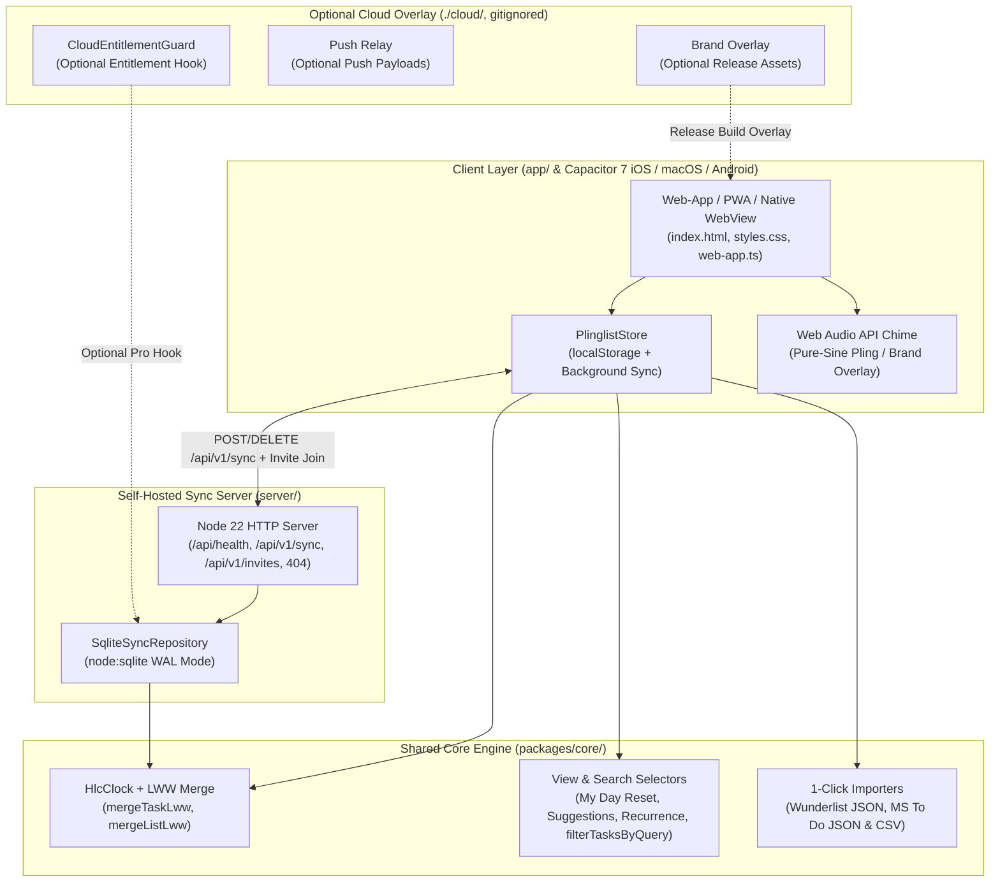

# Architecture of Plinglist

Plinglist is a fast, local-first, bilingual (EN/DE) to-do list application designed as a lightweight successor to Wunderlist and Microsoft To Do. This document describes the architectural principles, component layout, conflict-free delta synchronization, and open-core boundaries.

---

## 1. Architectural Philosophy: Local-First & Strict YAGNI

- **Instant Local Execution:** Every read and mutation (`addTask`, `toggleTaskCompleted`, `addTaskStep`, `updateTask`) executes synchronously against local memory and `localStorage` (`< 16 ms` UI latency, `< 200 ms` cold start). Network synchronization runs strictly asynchronously in the background.
- **Offline-First Resilience:** Tasks can be created, checked off, starred, and edited without network connectivity. All mutations carry Hybrid Logical Clock (HLC) timestamps for deterministic merging upon reconnect.
- **Strict YAGNI Scope:** Eight focused views (*My Day* with midnight reset + smart suggestions, *Starred*, *Planned* with time-window filters, overdue badges & recurrences, *All*, *Tasks*, *Assigned to me*, *Custom / Shared Lists* with 1-level folders, sorting, duplication & `#hashtags`, and *7-Day Trash*) plus debounced live search (`filterTasksByQuery`) and URL state (`?view=&list=&q=&legal=`). No Kanban boards, no AI bloat.
- **Zero External Runtime Dependencies:** Built directly on Node.js 22 LTS (`node:http`, `node:sqlite`, `node:module.stripTypeScriptTypes`, `node:test`) and standard browser primitives (`<dialog closedby="any">`, `details::details-content`, `HTMLInputElement.showPicker()`, Web Audio API, Service Worker, `color-scheme: light dark`, `light-dark()`).
- **Strict CSP Compatibility:** No inline `<script>` tags, no inline `style=""` attributes, and no external font/CDN dependencies.

---

## 2. System Overview



---

## 3. Conflict-Free Offline Delta Sync (HLC + Field-Level LWW)

Plinglist uses **Hybrid Logical Clocks** (`packages/core/src/hlc.ts`) formatted as zero-padded lexicographical strings:

```text
<15-digit-wallMs>:<5-digit-counter>:<nodeId>
```

- **Monotonicity:** `HlcClock.now(wallMs)` and `HlcClock.receive(remoteHlc, wallMs)` advance monotonically even when a device's system clock drifts backwards.
- **Field-Level LWW (`mergeTaskLww`):** Each task stores `fieldHlcs` across 14 mergeable fields (`listId`, `title`, `completed`, `completedAt`, `starred`, `myDayDate`, `dueDate`, `reminderAt`, `recurrence`, `note`, `steps`, `assignee`, `position`, `deletedAt`). If Device A checks off a task offline while Device B updates its note offline, both changes survive cleanly on merge.
- **List-Level LWW (`mergeListLww`):** Merges `title`, `folder`, `position`, `shared`, `inviteToken`, `readonlyInviteToken`, and soft-delete `deletedAt` by comparing record HLCs while retaining earliest `createdAt` and latest `updatedAt`.
- **Delta-Push Optimization (`lastPushedHlc`):** After initial workspace sync, `PlinglistStore.syncWithServer()` pushes only lists and tasks whose HLC exceeds `lastPushedHlc`, turning idle 15-second background polls (paused while the tab is hidden) into empty-body delta pulls.
- **7-Day Trash, Snapshots & GDPR Erasure:** Soft-deletions (`deleteTask`, `deleteList`) keep contents recoverable for 7 days (`FREE_TRASH_RETENTION_DAYS`) before `purgeExpiredTrash()` or `emptyTrash()` clears personal fields (`title`, `note`, `steps`, `dueDate`, `reminderAt`, `myDayDate`, `starred`, `assignee`). `SqliteSyncRepository` also stores daily gzipped `workspace_snapshots` (30-day retention), `workspace_devices` (2-device free cap with reinstall slot replacement), and `workspace_memberships`. Users can erase all local and server-stored workspace data anytime via `DELETE /api/v1/sync` or switch to local-only mode (`syncEnabled = false`).

---

## 4. Data Model & SQLite WAL Schema

`SqliteSyncRepository` (`server/src/sqlite-repo.ts`) uses Node 22's built-in `node:sqlite` (`DatabaseSync`) with:

```sql
PRAGMA journal_mode = WAL;
PRAGMA synchronous = NORMAL;
PRAGMA busy_timeout = 5000;
```

- **`lists` table:** `(id TEXT PRIMARY KEY, owner_sync_key TEXT, invite_token TEXT, readonly_invite_token TEXT, hlc TEXT NOT NULL, payload_json TEXT NOT NULL)` with indexes `idx_lists_invite`, `idx_lists_readonly_invite`, and `idx_lists_owner`.
- **`tasks` table:** `(id TEXT PRIMARY KEY, list_id TEXT NOT NULL, hlc TEXT NOT NULL, payload_json TEXT NOT NULL)` with index `idx_tasks_list_hlc`.
- **`workspace_devices`, `workspace_memberships` & `workspace_snapshots` tables:** Enforce 2-device free slots (with reinstall replacement), restore joined shared lists on `?pair=`, and store daily gzipped 30-day workspace snapshots.
- **`entitlements` table:** `(user_key TEXT PRIMARY KEY, plan TEXT NOT NULL, expires_at_ms INTEGER, source TEXT NOT NULL, updated_at TEXT NOT NULL)` storing normalized Stripe/RevenueCat Pro states.
- **Atomic Sync Transactions:** `applyAndPullDeltas` wraps incoming list and task merges in `BEGIN IMMEDIATE ... COMMIT` (with `ROLLBACK` on error) so concurrent sync requests remain consistent.

---

## 5. HTTP API Contract

| Method & Path | Purpose | Notes |
| :--- | :--- | :--- |
| `GET /api/health` | Liveness & healthcheck | Returns `{ status: "ok", service: "plinglist-app", cloudExtensionEnabled }` |
| `POST /api/v1/sync` | Idempotent HLC delta push & pull | Validates payload schema/bounds, enforces source/target list ownership on task moves, rate-limited (240 req/min/IP), returns `403 PRO_ENTITLEMENT_REQUIRED` when `CLOUD_ENFORCE_ENTITLEMENTS=true` without active entitlement |
| `DELETE /api/v1/sync` | GDPR workspace erasure | Deletes all lists owned by `syncKey` / `userId`, their tasks, and entitlements, returning `{ ok: true, deletedLists }` |
| `POST /api/v1/invites/:token/join` | Resolve shared list invite | Rate-limited (60 req/min/IP); returns `{ list }` or `404 INVITE_NOT_FOUND` |
| `GET /join/:token` | Browser invite entry | `302` redirect to `${PUBLIC_BASE_URL}/?join=<token>` |
| `POST /api/v1/cloud/webhooks/stripe` | Cloud billing webhook (`CLOUD_EXTENSION_ENABLED=true`) | Verifies required `Bearer ${CLOUD_WEBHOOK_SECRET}` via `crypto.timingSafeEqual` (fail-closed), persists Stripe `pro_yearly` / `pro_lifetime` / `free` into `entitlements` |
| `POST /api/v1/cloud/webhooks/revenuecat` | Cloud billing webhook (`CLOUD_EXTENSION_ENABLED=true`) | Verifies required `Bearer ${CLOUD_WEBHOOK_SECRET}` via `crypto.timingSafeEqual` (fail-closed), persists RevenueCat `pro_yearly` / `pro_lifetime` / `free` into `entitlements` |
| `GET /.well-known/apple-app-site-association` | Apple Universal Links manifest | Serves `applinks` for `${APPLE_TEAM_ID}.${APPLE_BUNDLE_ID}` across `/` and `/join/*` |
| `GET /.well-known/assetlinks.json` | Android App Links manifest | Serves `delegate_permission/common.handle_all_urls` for `de.goork.plinglist` with configured Google Play & upload SHA-256 fingerprints |
| `GET /` & static assets | App shell & static delivery | Sets `Referrer-Policy: no-referrer`, `X-Content-Type-Options: nosniff`, `X-Frame-Options: DENY`, `Content-Security-Policy`, `Cache-Control: no-cache` on mutable entries (`.html`, `.js`, `.css`, `sw.js`, `.webmanifest`), dynamic Open Graph tags + `X-Robots-Tag: noindex, nofollow` for `?join=` / `?pair=` (keeping browser `<title>` intact), and real `404` responses |
| `OPTIONS /api/*` | CORS preflight | Returns `204` with `Access-Control-Allow-Origin: *` (`GET, POST, DELETE, OPTIONS`) |

---

## 6. Open-Core & Brand Separation

- **Public Repo (`plinglist`, AGPLv3):** Contains the complete local-first app (with `getDefaultServerUrl()` same-origin resolution, `isNativeShellOrigin()` / `getShareBaseOrigin()` for Capacitor 7 iOS, Mac Catalyst & Android `https://localhost`, `includePlugins: ["@capacitor/app", "@capacitor/local-notifications"]`, `MainActivity.java` Edge-to-Edge/DayNight `AppTheme.NoActionBar` & Deep-Link bridges, `AppDelegate.swift` brand-tinted native pickers & Deep-Link bridges, unified `<select>` chevron/focus styling, Android `backButton` / drawer swipe-left handling, Network-First `sw.js`, Service-Worker + persisted reminder notifications, `?join=`/`?pair=` live URL extraction, and `plinglist://` deep links), core HLC engine, importers, CI/CD Capacitor wrapper workflows (`.github/workflows/build-ios-macos.yml`, `.github/workflows/build-android.yml`), and self-hosted SQLite WAL sync server. Uses a clean pure-sine Web Audio chime and no paywall enforcement by default.
- **Optional Private Cloud Overlay (`./cloud/`, gitignored):** Separates commercial billing/entitlement guards (`CloudEntitlementGuard`), optional push delivery, store metadata automation, and protected brand audio/icon assets (`TRADEMARK.md`) from the AGPLv3 open-core codebase. Release builds apply any present `./cloud/` overlay assets into `app/public/` and native wrapper resource directories before `scripts/build-app.mjs` compiles `app/dist/` and stamps `CACHE_NAME` from `package.json`.
