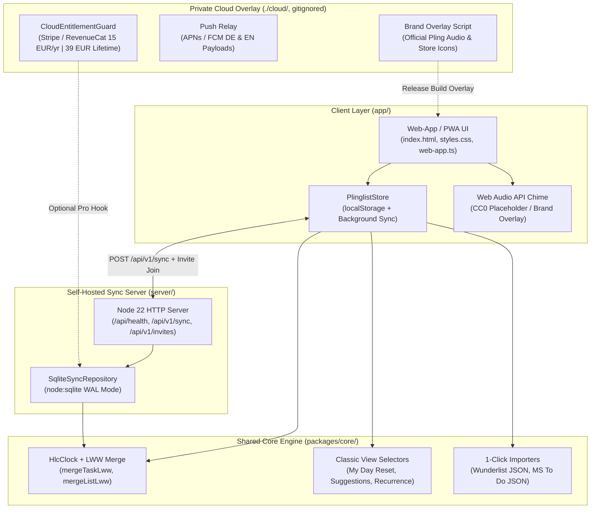

# Architecture of Plinglist

Plinglist is a fast, local-first, bilingual (EN/DE) to-do list application designed as a lightweight successor to Wunderlist and Microsoft To Do. This document describes the architectural principles, component layout, conflict-free delta synchronization, and open-core boundaries.

---

## 1. Architectural Philosophy: Local-First & Strict YAGNI

- **Instant Local Execution:** Every read and mutation (`addTask`, `toggleTaskCompleted`, `addTaskStep`, `updateTask`) executes synchronously against local memory and `localStorage` (`< 16 ms` UI latency, `< 200 ms` cold start). Network synchronization runs strictly asynchronously in the background.
- **Offline-First Resilience:** Tasks can be created, checked off, starred, and edited without network connectivity. All mutations carry Hybrid Logical Clock (HLC) timestamps for deterministic merging upon reconnect.
- **Strict YAGNI Scope:** Four classic views (*My Day* with automatic midnight reset + smart suggestions, *Starred*, *Planned* with due dates & recurrences, and *Lists / Shared Lists*). No Kanban boards, no AI bloat.
- **Zero External Runtime Dependencies:** Built directly on Node.js 22 LTS (`node:http`, `node:sqlite`, `node:module.stripTypeScriptTypes`, `node:test`) and standard browser primitives (`<dialog closedby="any">`, Web Audio API, Service Worker, `color-scheme: light dark`, `light-dark()`).
- **Strict CSP Compatibility:** No inline `<script>` tags, no inline `style=""` attributes, and no external font/CDN dependencies.

---

## 2. System Overview



---

## 3. Conflict-Free Offline Delta Sync (HLC + Field-Level LWW)

Plinglist uses **Hybrid Logical Clocks** (`packages/core/src/hlc.ts`) formatted as zero-padded lexicographical strings:

```text
<15-digit-wallMs>:<5-digit-counter>:<nodeId>
```

- **Monotonicity:** `HlcClock.now(wallMs)` and `HlcClock.receive(remoteHlc, wallMs)` advance monotonically even when a device's system clock drifts backwards.
- **Field-Level LWW (`mergeTaskLww`):** Each task stores `fieldHlcs` across 12 mergeable fields (`listId`, `title`, `completed`, `completedAt`, `starred`, `myDayDate`, `dueDate`, `reminderAt`, `recurrence`, `note`, `steps`, `deletedAt`). If Device A checks off a task offline while Device B updates its note offline, both changes survive cleanly on merge.
- **List-Level LWW (`mergeListLww`):** Merges `title`, `shared`, `inviteToken`, and soft-delete `deletedAt` by comparing record HLCs while retaining earliest `createdAt` and latest `updatedAt`.
- **Soft-Delete Tombstones:** Deletions set `deletedAt` rather than removing records immediately so deletions propagate reliably to offline peers.

---

## 4. Data Model & SQLite WAL Schema

`SqliteSyncRepository` (`server/src/sqlite-repo.ts`) uses Node 22's built-in `node:sqlite` (`DatabaseSync`) with:

```sql
PRAGMA journal_mode = WAL;
PRAGMA synchronous = NORMAL;
PRAGMA busy_timeout = 5000;
```

- **`lists` table:** `(id TEXT PRIMARY KEY, owner_sync_key TEXT, invite_token TEXT, hlc TEXT NOT NULL, payload_json TEXT NOT NULL)` with indexes `idx_lists_invite` and `idx_lists_owner`.
- **`tasks` table:** `(id TEXT PRIMARY KEY, list_id TEXT NOT NULL, hlc TEXT NOT NULL, payload_json TEXT NOT NULL)` with index `idx_tasks_list_hlc`.
- **`entitlements` table:** `(user_key TEXT PRIMARY KEY, plan TEXT NOT NULL, expires_at_ms INTEGER, source TEXT NOT NULL, updated_at TEXT NOT NULL)` storing normalized Stripe/RevenueCat Pro states.
- **Atomic Sync Transactions:** `applyAndPullDeltas` wraps incoming list and task merges in `BEGIN IMMEDIATE ... COMMIT` (with `ROLLBACK` on error) so concurrent sync requests remain consistent.

---

## 5. HTTP API Contract

| Method & Path | Purpose | Notes |
| :--- | :--- | :--- |
| `GET /api/health` | Liveness & healthcheck | Returns `{ status: "ok", service: "plinglist-app", cloudExtensionEnabled }` |
| `POST /api/v1/sync` | Idempotent HLC delta push & pull | Merges `clientLists` & `clientTasks`, returns deltas newer than `sinceHlc` + new `cursorHlc` (returns `403 PRO_ENTITLEMENT_REQUIRED` when `CLOUD_ENFORCE_ENTITLEMENTS=true` without active entitlement) |
| `POST /api/v1/invites/:token/join` | Resolve shared list invite | Returns `{ list }` or `404 INVITE_NOT_FOUND` |
| `GET /join/:token` | Browser invite entry | `302` redirect to `${PUBLIC_BASE_URL}/?join=<token>` |
| `POST /api/v1/cloud/webhooks/stripe` | Cloud billing webhook (`CLOUD_EXTENSION_ENABLED=true`) | Verifies optional `Bearer ${CLOUD_WEBHOOK_SECRET}`, persists Stripe `pro_yearly` / `pro_lifetime` / `free` into `entitlements` |
| `POST /api/v1/cloud/webhooks/revenuecat` | Cloud billing webhook (`CLOUD_EXTENSION_ENABLED=true`) | Verifies optional `Bearer ${CLOUD_WEBHOOK_SECRET}`, persists RevenueCat `pro_yearly` / `pro_lifetime` / `free` into `entitlements` |
| `OPTIONS /api/*` | CORS preflight | Returns `204` with `Access-Control-Allow-Origin: *` |

---

## 6. Open-Core & Brand Separation

- **Public Repo (`plinglist`, AGPLv3):** Contains the complete local-first app (with `getDefaultServerUrl()` same-origin resolution), core HLC engine, importers, and self-hosted SQLite WAL sync server. Uses a neutral CC0 Web Audio synthesizer chime and no paywall enforcement by default.
- **Private Cloud Repo (`./cloud/`, gitignored):** Holds Stripe/RevenueCat entitlement checks (`CloudEntitlementGuard`), APNs/FCM push notification payload builders, Contabo deployment workflows, and protected Plinglist trademarks/audio (`TRADEMARK.md`). During release builds, `apply-brand-overlay.sh` copies protected assets into `app/public/` and `scripts/build-app.mjs` mirrors `app/public/` into `app/dist/`.
